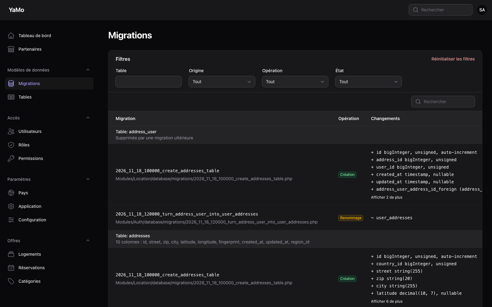

# bza/laravel-migration-viewer

Read-only viewer of a Laravel application's migration files, grouped by table.
The migrations of nwidart/laravel-modules modules and of packages are included.
A Filament adapter ships with it.

For each migration and each table it touches, the viewer shows:

- the operation: create, alter, rename, drop, or data (no schema change);
- each change, one per line:
  - `+ title string(100), nullable`
  - `− price`
  - `~ name → title`
  - `+ users_email_unique unique (email)`
  - `+ users_country_id_foreign (country_id) → countries(id), on delete set null`
- the origin of the file: application, module (with its name), generated, or package;
- whether the migration has run.

Each table also gets a summary of its columns as the migrations leave it, or a mention that a later migration dropped it.



## How it works

The migration files are not parsed. Each migration's `up()` method is replayed the way `php artisan migrate --pretend` replays it:

- every configured connection is in *pretend* mode, so queries are recorded and never sent to the database;
- the schema builder resolves every `Blueprint` from the container, and a container hook keeps the blueprints created during the replay.

Each blueprint gives its columns and commands, which become the changes.

Replaying instead of parsing means that table names computed in code, such as `config('permission.table_names.roles')`, resolve correctly. It also has limits:

- checks such as `Schema::hasTable()` or `Schema::hasColumn()` see an empty database, so a branch guarded by one may be skipped or taken wrongly;
- code that does more than query the database still runs: files, cache, events, mails. Keep such code out of migrations;
- a migration that throws keeps what it recorded before the exception, and the page lists it as incomplete.

```
src/
├── MigrationInspector.php      Entry point: files, replays, changes by table, table summaries
├── Contracts/MigrationSource   Lists migration files with their origin
├── Sources/                    Application, Module (nwidart), Generated and Registered (loadMigrationsFrom) sources
├── Replay/                     Pretend replay, blueprint collector and reader, column describer
├── Data/                       Immutable value objects (MigrationFile, TableChange, ChangeDetail, TableSummary…)
├── Generator/                  Create / edit a table → one migration file (current columns, diff, code writer)
├── MigrationTableSynchronizer  Stores the table summaries in migration_tables
├── Models/MigrationTable       Eloquent model of migration_tables
├── Console/                    migration-viewer:sync
└── Filament/                   Thin adapter: plugin, migrations page, stored tables' resource
```

The core knows nothing of Filament. Another adapter, such as a Blade page, an Artisan command or a JSON endpoint, only needs `MigrationInspector`:

```php
use Bza\MigrationViewer\Data\MigrationQuery;
use Bza\MigrationViewer\MigrationInspector;

$inspector = app(MigrationInspector::class);

$inspector->changes(new MigrationQuery(table: 'users'));   // list<TableChange>, in run order
$inspector->table('users')?->columns;                      // ['id' => 'bigInteger, unsigned, auto-increment', …]
$inspector->failures();                                    // migrations whose replay threw
```

## Installation

```bash
composer require bza/laravel-migration-viewer
```

Add the page to a Filament panel:

```php
use Bza\MigrationViewer\Filament\MigrationViewerPlugin;

$panel->plugin(MigrationViewerPlugin::make()
    ->navigationGroup('Settings')
    ->navigationSort(120)
    ->authorize(fn (): bool => auth()->user()->isSuperAdmin()));
```

Every option accepts a closure. The page lists:

- filters: table, origin, module (shown only when the origin is « Module »), operation, status;
- a search on table, migration and column or index names.

A click on a row opens its table's detail page. Migrations that touch no table have no detail.

## Stored tables

The package's migration creates a `migration_tables` table with one row per table the migrations touch. The table name is unique. Each row holds:

- `dropped`;
- the current `columns` (name and definition);
- the `migrations` that touch the table (name, path, operation, origin, module, status, changes);
- `columns_count`, `migrations_count`, `pending_count`, `last_migration`, `synced_at`.

`MigrationTableSynchronizer::sync()` fills the table and removes rows for tables no migration touches any more. It runs:

- after each `migrate` or `migrate:rollback`, unless `sync_after_migrate` is false;
- with `php artisan migration-viewer:sync`;
- from the « Synchronize » button of the list page.

The Filament plugin also registers the `MigrationTableResource` resource. It is read-only and shares the plugin's `authorize()`:

- the list (`/migration-tables`) offers a search on the name and filters for dropped tables and tables with pending migrations;
- the detail page (`/migration-tables/{name}`) shows the table's state, its migration files with their operation, changes, origin and status, then its current columns.

The `migration_tables` model is `Bza\MigrationViewer\Models\MigrationTable`, addressed by its name in URLs.

## Generating migrations

The « Tables » list has a « Nouvelle table » button and each table's detail page a « Modifier la table » button. Each opens a page whose form is written as **one** migration file in the generator's directory, in the style of `make:migration`. The file is never run: it shows as pending until you run `php artisan migrate`.

**Create page** (`/migration-tables/create`): the table's name, whether to add an `id` primary key, timestamps and soft deletes, then its columns. The form writes `create_<table>_table`.

**Edit page** (`/migration-tables/{name}/edit`): the form starts from the table as the migrations leave it, with every current column as an item. You can:

- rename the table;
- rename a column or change its definition;
- remove an item to drop the column;
- add items for new columns.

All the changes go into one `alter_<table>_table` file:

- the table rename;
- then, in one `Schema::table()`: dropped keys and columns, renamed columns, changed definitions (`->change()`, with every attribute restated) with their keys, and new columns.

Its `down()` undoes the changes in reverse order. Keys are dropped by their real names, which they keep after a table rename, and by their columns, which SQLite needs.

The generator only rewrites what it can write itself. A column it cannot rewrite shows as kept as is and can only be kept or dropped. That covers:

- an auto-increment key;
- a computed column;
- an expression default or `useCurrent`;
- an enum;
- an unsigned small integer;
- a foreign key on another column than `id`.

Such a column cannot be restored by `down()` once dropped; the file says so in a comment.

Each item of the list shows its column in one line (`string(30), nullable, unique`). The fields of a column are edited in a slide-over on the right:

- « Ajouter un champ » opens it empty; the column joins the list once its fields are valid;
- the pencil of an item opens it filled with that column; « Appliquer » replaces the item.

A name another column already uses is refused. A column the generator cannot rewrite has no pencil: it can only be kept or removed.

The edit page also has two buttons that run migrations, each after a confirmation that lists them:

- **« Migrer la table »** runs only the pending files that touch this table (`migrate --path=… --realpath`). The other pending migrations stay pending and run at the next `migrate`, even if they are dated earlier. A file that depends on another pending migration (a foreign key to a table not created yet) fails: migrate that one first, or use « Tout migrer ».
- **« Tout migrer »** runs `php artisan migrate`: every pending migration of the application, the generated files included.

Unsaved changes of the form are not part of either: generate the migration first. `migration_tables` is then refreshed by the after-migrate sync. Each button is disabled when it has nothing to run, and only shows where the generator is enabled.

**Fields of a column:**

- name, type, length (string, char), digits and decimals (decimal);
- nullable, default, unique, index;
- for a `foreignId`: the referenced table (guessed from the name when empty) and what happens on delete (cascade, set null, restrict).

The types are Blueprint method names; `ColumnType` lists the ones offered.

**What the generator refuses:**

- an existing table;
- a name that is not lower case, digits and `_`;
- two columns with the same name;
- a column the table options already add;
- `set null` on a column that is not nullable;
- an edit that changes nothing.

The file is dated now, or one second after the last existing migration when one is dated later, so it always runs after the migrations it builds on.

The directory (`generator.path`, `database/migrations/migration-viewer` by default) is registered on the migrator, so `migrate` runs its files. The viewer lists them with the « Generated » origin. Writing files from a web page is only enabled in the `local` environment unless `generator.enabled` says otherwise.

The core can be used without Filament:

```php
use Bza\MigrationViewer\Generator\{ColumnEdit, ColumnType, MigrationGenerator, NewColumn, NewTable, OnDelete};

$generator = app(MigrationGenerator::class);

$generator->createTable(new NewTable('invoices', [
    new NewColumn('number', ColumnType::String, length: 20, unique: true),
    new NewColumn('user_id', ColumnType::ForeignId, nullable: true, onDelete: OnDelete::SetNull),
]));

// Every column to keep, by its current name; the others are dropped.
$generator->alterTable('invoices', 'invoices', [
    new ColumnEdit('id', null),                                             // kept as is
    new ColumnEdit('number', new NewColumn('reference', ColumnType::String)), // renamed and changed
    new ColumnEdit(null, new NewColumn('paid_at', ColumnType::DateTime, nullable: true)), // new
]);
```

## Configuration

```bash
php artisan vendor:publish --tag=migration-viewer-config
```

| Key | Default | Meaning |
| --- | --- | --- |
| `sources` | application, module, registered | Classes implementing `MigrationSource`; a file listed twice keeps the first source. |
| `connections` | `null` (all) | Connections put in pretend mode during a replay. |
| `generator.enabled` | `true` in `local` only (`MIGRATION_VIEWER_GENERATOR_ENABLED`) | Open the create and edit pages. |
| `generator.path` | `database/migrations/migration-viewer` (`MIGRATION_VIEWER_GENERATOR_PATH`) | Where generated files are written; read by `migrate` and the viewer. |
| `sync_after_migrate` | `true` (`MIGRATION_VIEWER_SYNC_AFTER_MIGRATE`) | Refresh `migration_tables` after each migrate or rollback. |

Translations (en, fr, de) can be published with the `migration-viewer-translations` tag.

## Tests

The tests run inside the host application, on fixture migrations only:

```bash
php artisan test packages/migration-viewer/tests
```
